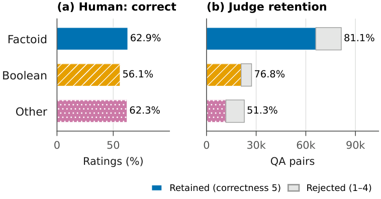
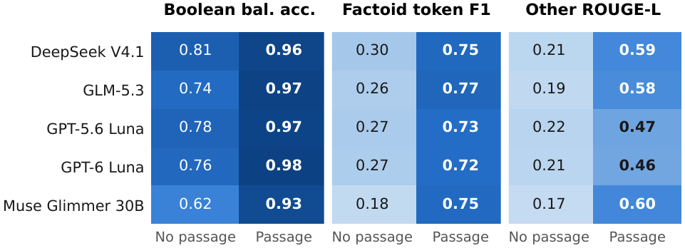

# BharatSynthQA

A context-grounded question answering dataset on Indian temples and the religious sites connected to them. Every question comes with the Wikipedia passage it was generated from.

[](https://huggingface.co/datasets/theshivam7/bharatsynth-qa)
[](https://creativecommons.org/licenses/by-sa/4.0/)

| | |
|---|---|
| **Dataset** | [theshivam7/bharatsynth-qa](https://huggingface.co/datasets/theshivam7/bharatsynth-qa) on Hugging Face |
| **Paper** | Link coming soon |
| **Size** | 98,677 question-answer pairs from 7,485 Wikipedia articles |
| **Question types** | Boolean, Factoid, Other (explanatory) |
| **Language** | English |

## Quick start

```python
from datasets import load_dataset

ds = load_dataset("theshivam7/bharatsynth-qa")
print(ds["train"][0])
```

| Split | Pairs |
|---|---:|
| train | 69,074 |
| validation | 9,868 |
| test | 19,735 |

Fields, counts per question type and the dataset card are on the [Hugging Face page](https://huggingface.co/datasets/theshivam7/bharatsynth-qa).

## How the dataset was built

1. **Seeds:** topics from official temple trust websites and government tourism portals.
2. **Crawl and filter:** a topic-based crawler over Wikipedia. Articles are kept if their topic similarity to the seeds is at least 0.2 and, for articles about a physical site, if the site is in India (OpenStreetMap and Google Geocoding). This leaves 7,617 relevant articles.
3. **Generation:** about 300 human-written pairs serve as few-shot examples. [Llama 4 Scout](https://www.together.ai/models/llama-4-scout) generates 131,494 pairs.
4. **Judging:** [DeepSeek V4 Flash 0731](https://www.together.ai/models/deepseek-v4-flash-0731) scores each pair against its passage. Pairs with an answer-correctness score of 5 are kept, which gives the 98,677 pairs in the release.

## Results at a glance

- In a human check of 200 raw generated pairs (three raters each), 89.83% of questions were rated clear and 61.33% of answers fully correct. The judge filter was applied after this check.
- Models know little about this domain but read the passages well. In zero-shot tests of five LLMs, Factoid token F1 is 0.18 to 0.30 without the source passage and 0.73 to 0.77 with it.

**Quality filtering.** Human ratings (a) and the share of generated pairs the LLM judge kept (b).



**Zero-shot benchmark** with and without the source passage.



## Citation

If you use BharatSynthQA, please cite the dataset. GitHub also shows a "Cite this repository" button from [`CITATION.cff`](CITATION.cff).

```bibtex
@misc{naik2026bharatsynthqa,
  title        = {BharatSynthQA: A Context-Grounded Question Answering Dataset on Indian Temples and Religious Heritage},
  author       = {Naik, Riya and Sharma, Shivam and Agarwal, Swati},
  year         = {2026},
  howpublished = {Hugging Face Datasets},
  url          = {https://huggingface.co/datasets/theshivam7/bharatsynth-qa}
}
```

## License

This repository (documentation and figures) and the dataset are released under [CC BY-SA 4.0](LICENSE). The dataset passages come from English Wikipedia, which uses the same license.
